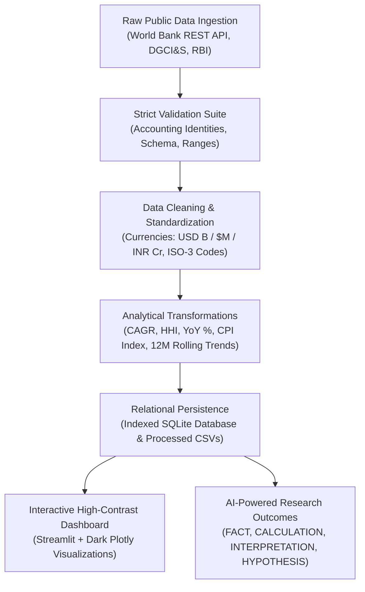

# 🌐 INDIA TRADE INTELLIGENCE
### Research-Grade Economics & International Trade Data Platform

[](https://www.python.org/)
[](https://streamlit.io/)
[]()
[]()
[]()

---

> 🏛️ **DATA PROVENANCE & TEMPORAL AUDIT NOTICE (October 2026):**  
> This platform has been independently audited for economic data provenance, accounting identities, and temporal accuracy.  
> - **Latest Complete Annual Data:** Calendar Year 2024 (World Bank WDI) and Financial Year 2023-24 (DGCI&S).  
> - **Provisional Horizon:** FY 2024-25 Quarter 1 (April–July) momentum annualized/interim as reported in preliminary releases.  
> - **Strict Temporal Grounding:** Historical benchmark data (e.g. 2024) is strictly labeled with its explicit year and is never mischaracterized as "Today" or "Live".

---

## 🎯 Executive Overview & Research Goal

**INDIA TRADE INTELLIGENCE** is a research-grade economics application designed to analyze, model, and interpret India's foreign trade dynamics through verified public datasets.

Rather than acting as a generic economics dashboard, this application enforces:
- **Strict Empirical Data Engineering**: Multi-tier pipeline maintaining strict separation between raw and processed data.
- **Accurate & Real Story of the Indian Economy**: Grounded economic studies evaluating the Post-2020 export breakout, the Russian crude pivot, the Mobile PLI surge, and the services cushion.
- **Inflation & Real Purchasing Power**: Interactive simulator revealing the erosion in the real value of the Rupee and physical commodity purchasing power over 30 years (1995–2024).
- **Econometric Rigor**: OLS secular trend decomposition, Herfindahl-Hirschman (HHI) concentration indices, rolling volatility smoothing, and pre/post-COVID structural mean comparisons.
- **Epistemic AI Research Layer**: Outcomes partitioned into **FACT**, **CALCULATION**, **INTERPRETATION**, and **HYPOTHESIS**, with mathematical verification to eliminate numerical hallucinations.
- **Methodological Guardrails**: Explicit warnings preventing correlation-causation fallacies.
- **High-Contrast Dark Theme**: All interactive Plotly figures rendered in high-contrast dark styling with vivid text and map contrast.

---

## 🧭 Curated Empirical Research Inquiries Answered

| Curated Inquiry | Empirical Methodology | Real Economic Finding |
|---|---|---|
| **1. Post-2020 Export Breakout** | OLS secular trend, 10-Yr CAGR, Pre/Post-COVID break | Total exports crossed **$829.8B** (CY 2024), driven by high-value refined petroleum, smartphones, and pharmaceuticals (+53.2% post-COVID jump). |
| **2. Russian Oil Re-routing** | Bilateral shift, crude price discount tracking | Russia surged from under $4B pre-2022 to **$61.4B** in FY24, displacing traditional Gulf suppliers and boosting domestic refining crack spreads. |
| **3. Mobile & Electronics PLI** | Sectoral inflection curves, CAGR | Electronics exports jumped from $7.6B (FY18) to **$29.1B** (FY24) under the PLI scheme, though gross component imports remain high ($89.8B). |
| **4. Goods Deficit vs Services Surplus** | Net coverage ratio, BoP Current Account metrics | Persistent merchandise deficit (~$238B) is counterbalanced by software and professional services surpluses ($170B+), keeping net goods & services deficit at -$65.2B (~1.8% of GDP) and avoiding a BoP crisis. |
| **5. Currency Depreciation Paradox** | Pearson correlation, real vs nominal exchange rates | INR/USD depreciation from ₹32 (1995) to ₹84+ (2025) does not eliminate deficit because crude and components are price-inelastic. |
| **6. China Intermediate Dependence** | Bilateral coverage ratio, input decomposition | Deficit with China exceeds -$85B, concentrated in essential manufacturing inputs (APIs, solar cells, display panels) rather than consumer toys. |
| **7. Provisional FY 2024-25 Q1 Trajectory** | High-frequency monthly tracking, freight indices | Quarter 1 (April–July) data tracks exports toward ~$880B annualized despite Red Sea container route friction. |
| **8. Purchasing Power Erosion & Terms of Trade** | CPI index compounding, Rule of 70, real basket | The Rupee's domestic purchasing power halves every ~12.0 years at ~5.82% mean inflation; ₹1,000 from 2000 retains ~₹235 of goods purchasing capacity in 2024 benchmark terms. |

---

## 🛒 Inflation & Purchasing Power (Value of Your Money)

The platform features an interactive real-economy simulator answering: **"What is the real value of your money?"**

- **Cumulative CPI Compounding**: Derives India's price index with compounding annual inflation rates from 1995 to 2024 (30 annual observations).
- **Purchasing Power Retention**: Shows how much purchasing capacity remains from ₹100, ₹1,000, or ₹10,000 across decades.
- **Headline CPI vs Retail Price Benchmarks**:
  - *Headline CPI (MoSPI)*: Weighted representative basket of 299 goods and services.
  - *Representative Commodity Benchmarks (Documented Historical Retail Proxies)*:
    - 🌾 **Rice (Staple Food)**: ₹9.5/kg (1995) vs ₹60/kg (2024 benchmark) / ₹64/kg (2025 benchmark)
    - ⛽ **Petrol (Transport Energy)**: ₹18.0/L (1995) vs ₹97/L (2024 benchmark) / ₹98/L (2025 benchmark)
    - 🔥 **LPG Cylinder (14.2kg)**: ₹135 (1995) vs ₹850 (2024 benchmark) / ₹870 (2025 benchmark)
    - 🍲 **Wholesome Meal / Thali**: ₹10 (1995) vs ₹125 (2024 benchmark) / ₹135 (2025 benchmark)
    - 🎟️ **Cinema Ticket**: ₹15 (1995) vs ₹320 (2024 benchmark) / ₹350 (2025 benchmark)
    - 🪙 **24K Gold**: ₹468/g (1995) vs ₹7,200/g (2024 benchmark) / ₹7,800/g (2025 benchmark)

### Advanced Econometric Formulations:
1. **Purchasing Power Parity (PPP) & Real Exchange Rate:**
   $$RER = e \times \frac{P^*}{P}$$
2. **Real Terms of Trade (Real ToT):**
   $$ToT_{\text{real}} = \frac{P_x / P_{x,\text{base}}}{P_m / P_{m,\text{base}}} \times 100$$
3. **Rule of 70 for Approximate Currency Purchasing Power Halving:**
   $$T_{\text{half}} \approx \frac{70}{\bar{\pi}}$$
4. **Real Trade Valuation Deflator:**
   $$V_{\text{real}} = \frac{V_{\text{nominal}}}{\text{CPI} / 100}$$

---

## 📊 Data Pipeline Architecture



---

## 🏛️ Official Data Sources & Provenance Registry

| Metric Identifier | Official Source | Observation Horizon | Frequency | Measurement Unit | Accounting Definition | Data Status |
|---|---|---|---|---|---|---|
| `macro_exports_gnfs` | World Bank WDI (`NE.EXP.GNFS.CD`) | 1995–2024 | Calendar Year | Current US$ Billion | Goods and market services credits | Official Final |
| `macro_imports_gnfs` | World Bank WDI (`NE.IMP.GNFS.CD`) | 1995–2024 | Calendar Year | Current US$ Billion | Goods and market services debits | Official Final |
| `macro_trade_balance` | Derived Accounting Identity | 1995–2024 | Calendar Year | Current US$ Billion | Balance = Exports - Imports | Derived Identity |
| `macro_trade_openness` | Derived Econometric Ratio | 1995–2024 | Calendar Year | % of GDP | ((Exports + Imports) / GDP) * 100 | Derived Metric |
| `macro_cpi_inflation` | World Bank WDI (`FP.CPI.TOTL.ZG`) / MoSPI | 1995–2024 (30 obs) | Calendar Year | Annual % Change | Headline consumer price change | Official Final |
| `bilateral_merchandise_trade` | DGCI&S, Ministry of Commerce | FY14–FY24 (Final) / FY25 Q1 (Prov) | Financial Year | US$ Million / INR Cr | Customs physical merchandise | Official Final / Prov |
| `commodity_merchandise_trade` | DGCI&S, Ministry of Commerce | FY14–FY24 (Final) / FY25 Q1 (Prov) | Financial Year | US$ Million / INR Cr | 17 Principal sectors (ITC-HS) | Official Final / Prov |
| `monthly_merchandise_trade` | Reserve Bank of India (DBIE) | 2018–2025 | Monthly | US$ Million | Monthly customs merchandise | Official Monthly |
| `commodity_basket_benchmark` | Documented Retail Market Proxies | 1995–2025 Milestones | Quinquennial | INR per unit | Representative physical basket | Benchmark Proxy |

---

## 🚀 Quickstart & Reproducibility Guide

```powershell
# 1. Navigate to workspace
cd "india_trade_intelligence"

# 2. Run the Data Pipeline
python run_pipeline.py

# 3. Run all Tests (including Data Audit Suite)
python -m pytest tests -v

# 4. Launch the Dashboard
streamlit run app.py
```
Open [http://localhost:8501](http://localhost:8501) in your browser.
