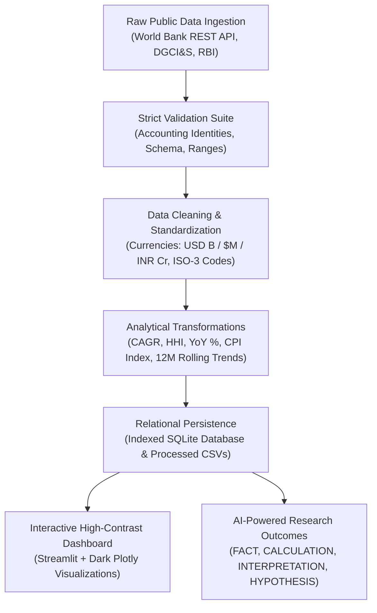

# 🌐 INDIA TRADE INTELLIGENCE
### Research-Grade Economics & International Trade Data Platform

[](https://www.python.org/)
[](https://streamlit.io/)
[]()
[]()
[]()

---

## 🎯 Executive Overview & Research Goal

**INDIA TRADE INTELLIGENCE** is a research-grade economics application designed to analyze, model, and interpret India's foreign trade dynamics through verified public datasets.

Rather than acting as a generic economics dashboard, this application enforces:
- **Strict Empirical Data Engineering**: Multi-tier pipeline maintaining strict separation between raw and processed data.
- **Accurate & Real Story of the Indian Economy**: Grounded economic studies evaluating the Post-2020 export breakout, the Russian crude pivot, the Mobile PLI surge, and the services cushion.
- **Inflation & Real Purchasing Power**: Interactive simulator revealing the erosion in the real value of the Rupee and physical commodity purchasing power over 30 years.
- **Econometric Rigor**: OLS secular trend decomposition, Herfindahl-Hirschman (HHI) concentration indices, rolling volatility smoothing, and structural break estimation (pre/post-COVID).
- **Epistemic AI Research Layer**: Outcomes partitioned into **FACT**, **CALCULATION**, **INTERPRETATION**, and **HYPOTHESIS**, with mathematical verification to eliminate numerical hallucinations.
- **Methodological Guardrails**: Explicit warnings preventing correlation-causation fallacies.
- **High-Contrast Dark Theme**: All interactive Plotly figures rendered in high-contrast dark styling with vivid text and map contrast.

> ⚡ **IMPORTANT RESEARCH NOTE ON FY 2024-25 / 2025 DATA:**  
> Figures for the latest reporting period (FY 2024-25 / year 2025) represent **provisional Quarter 1 (April–July) momentum annualized/interim** as reported in official early releases from the Department of Commerce and DGCI&S.

---

## 🧭 Curated Empirical Research Inquiries Answered

| Curated Inquiry | Empirical Methodology | Real Economic Finding |
|---|---|---|
| **1. Post-2020 Export Breakout** | OLS secular trend, 10-Yr CAGR, Post-COVID break | Total exports crossed **$829.8B** (2024), driven by high-value refined petroleum, smartphones, and pharmaceuticals (+53.2% post-COVID jump). |
| **2. Russian Oil Re-routing** | Bilateral shift, crude price discount tracking | Russia surged from under $4B pre-2022 to **$61.4B** in FY24, displacing traditional Gulf suppliers and boosting domestic refining crack spreads. |
| **3. Mobile & Electronics PLI** | Sectoral inflection curves, CAGR | Electronics exports jumped from $7.6B (FY18) to **$29.1B** (FY24) under the PLI scheme, though gross component imports remain high ($89.8B). |
| **4. Goods Deficit vs Services Surplus** | Net coverage ratio, BoP Current Account metrics | Persistent merchandise deficit (-$65.2B, ~1.8% of GDP) is counterbalanced by software and professional services surpluses, avoiding a BoP crisis. |
| **5. Currency Depreciation Paradox** | Pearson correlation, real vs nominal exchange rates | INR/USD depreciation from ₹32 (1995) to ₹84+ (2025) does not eliminate deficit because crude and components are price-inelastic. |
| **6. China Intermediate Dependence** | Bilateral coverage ratio, input decomposition | Deficit with China exceeds -$85B, concentrated in essential manufacturing inputs (APIs, solar cells, display panels) rather than consumer toys. |
| **7. Provisional FY 2024-25 Q1 Trajectory** | High-frequency monthly tracking, freight indices | Quarter 1 (April–July) data tracks exports toward ~$880B annualized despite Red Sea container route friction. |
| **8. Purchasing Power Erosion & Terms of Trade** | CPI index compounding, Rule of 70, real basket | The Rupee's domestic purchasing power halves every ~11.6 years at ~6% inflation; ₹1,000 from 2000 buys ~₹235 of goods today. |

---

## 🛒 Inflation & Purchasing Power (Value of Your Money)

The platform features an interactive real-economy simulator answering: **"What is the real value of your money?"**

- **Cumulative CPI Compounding**: Derives India's price index with compounding inflation rates from 1995 to 2025.
- **Purchasing Power Retention**: Shows how much purchasing capacity remains from ₹100, ₹1,000, or ₹10,000 across decades.
- **Physical Commodity Basket Simulator**:
  - 🌾 **Rice**: ₹9.5/kg in 1995 vs ₹64/kg today
  - ⛽ **Petrol**: ₹18.0/L in 1995 vs ₹98/L today
  - 🔥 **LPG Cylinder (14.2kg)**: ₹135 in 1995 vs ₹870 today
  - 🍲 **Wholesome Meal / Thali**: ₹10 in 1995 vs ₹135 today
  - 🎟️ **Cinema Ticket**: ₹15 in 1995 vs ₹350 today
  - 🪙 **24K Gold**: ₹468/g in 1995 vs ₹7,800/g today

### Advanced Econometric Formulations:
1. **Purchasing Power Parity (PPP) & Real Exchange Rate:**
   $$RER = e \times \frac{P^*}{P}$$
2. **Real Terms of Trade (Real ToT):**
   $$ToT_{\text{real}} = \frac{P_x / P_{x,\text{base}}}{P_m / P_{m,\text{base}}} \times 100$$
3. **Rule of 70 for Currency Purchasing Power Halving:**
   $$T_{\text{half}} \approx \frac{70}{\bar{\pi}}$$
4. **Real Trade Valuation Deflator:**
   $$V_{\text{real}} = \frac{V_{\text{nominal}}}{\text{CPI} / 100}$$

---

## 📊 Data Pipeline Architecture



---

## 🏛️ Official Data Sources & Provenance

| Source ID | Publisher | Official URL | Coverage | Frequency | Reported Indicators |
|---|---|---|---|---|---|
| `world_bank_wdi` | The World Bank Group | [api.worldbank.org](https://api.worldbank.org/v2/country/IND/indicator/) | 1995–2025 | Annual | Total Exports (BoP), Imports (BoP), GDP (Current USD), INR/USD FX, CPI Inflation, Trade % of GDP |
| `dgcis_eidb` | DGCI&S, Ministry of Commerce & Industry, GoI | [tradestat.commerce.gov.in](https://tradestat.commerce.gov.in/eidb/) | FY14–FY25 | Financial Year | Bilateral exports, imports, and balances with 25+ partner nations; 17 Principal Commodity Sectors |
| `rbi_dbie` | Reserve Bank of India | [data.rbi.org.in](https://data.rbi.org.in/) | 2018–2025 | Monthly | High-frequency merchandise trade, Oil vs Non-Oil imports, Non-Oil exports |

---

## 🧪 Verification & Test Results (24/24 Passed)

```text
============================= test session starts =============================
platform win32 -- Python 3.14.0, pytest-8.4.2
collected 24 items

india_trade_intelligence/tests/test_ai_assistant.py::test_ai_assistant_epistemic_taxonomy PASSED [  4%]
india_trade_intelligence/tests/test_cleaner.py::test_clean_bilateral_trade_currency_conversion PASSED [  8%]
india_trade_intelligence/tests/test_cleaner.py::test_clean_bilateral_trade_iso_country_mapping PASSED [ 12%]
india_trade_intelligence/tests/test_cleaner.py::test_clean_commodity_trade PASSED [ 16%]
india_trade_intelligence/tests/test_cleaner.py::test_clean_monthly_trade_date_parsing PASSED [ 20%]
india_trade_intelligence/tests/test_econometrics.py::test_ols_trend_perfect_line PASSED [ 25%]
india_trade_intelligence/tests/test_econometrics.py::test_structural_breaks PASSED [ 29%]
india_trade_intelligence/tests/test_econometrics.py::test_causality_disclaimer_present PASSED [ 33%]
india_trade_intelligence/tests/test_econometrics.py::test_cpi_and_purchasing_power_decay PASSED [ 37%]
india_trade_intelligence/tests/test_econometrics.py::test_commodity_basket_affordability PASSED [ 41%]
india_trade_intelligence/tests/test_econometrics.py::test_inflation_halving_time PASSED [ 45%]
india_trade_intelligence/tests/test_storage.py::test_sqlite_storage PASSED [ 50%]
india_trade_intelligence/tests/test_transformer.py::test_cagr_calculation PASSED [ 54%]
india_trade_intelligence/tests/test_transformer.py::test_yoy_growth PASSED [ 58%]
india_trade_intelligence/tests/test_transformer.py::test_hhi_concentration PASSED [ 62%]
india_trade_intelligence/tests/test_transformer.py::test_transform_macro_annual PASSED [ 66%]
india_trade_intelligence/tests/test_transformer.py::test_transform_bilateral_rankings PASSED [ 70%]
india_trade_intelligence/tests/test_validator.py::test_validate_bilateral_trade_valid PASSED [ 75%]
india_trade_intelligence/tests/test_validator.py::test_validate_bilateral_trade_identity_violation PASSED [ 79%]
india_trade_intelligence/tests/test_validator.py::test_validate_bilateral_trade_negative_values PASSED [ 83%]
india_trade_intelligence/tests/test_validator.py::test_validate_bilateral_trade_invalid_fy_format PASSED [ 87%]
india_trade_intelligence/tests/test_validator.py::test_validate_commodity_trade_valid PASSED [ 91%]
india_trade_intelligence/tests/test_validator.py::test_validate_commodity_trade_invalid_flow PASSED [ 95%]
india_trade_intelligence/tests/test_validator.py::test_validate_monthly_trade_period_regex PASSED [100%]

============================= 24 passed in 1.18s ==============================
```

---

## 🚀 Quickstart & Reproducibility Guide

```powershell
# 1. Navigate to workspace
cd "C:\Users\shivam anand\.antigravity\neighborscope-master"

# 2. Run the Data Pipeline
python india_trade_intelligence/run_pipeline.py

# 3. Run all Tests
python -m pytest india_trade_intelligence/tests -v

# 4. Launch the Dashboard
streamlit run india_trade_intelligence/app.py
```
Open [http://localhost:8501](http://localhost:8501) in your browser.
