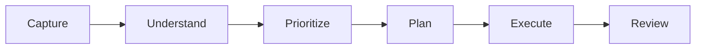

# 🎓 Student Chief of Staff

> A local-first, lightweight personal operating system designed to help students master academic projects, upcoming deadlines, deep learning, job searching, and daily responsibilities.

---

## 🌟 Vision & Operating Philosophy

Most productivity apps are either passive to-do lists that pile up guilt or generic chatbots that hallucinate dates and lack persistent memory.

**Student Chief of Staff** is built differently:
1. **Local-First & Private:** Everything persists in a local SQLite database (`student_cos.db`). No cloud lock-in.
2. **Deterministic Time Scheduling:** Date math and schedule packing are executed in **pure Python** using interval arithmetic and weighted priority scoring—never left to LLM guesswork.
3. **Controlled Tool Calling:** The AI assistant reads and modifies state strictly through validated deterministic tools with schema enforcement.
4. **Offline by Default:** Includes a smart, zero-API deterministic heuristic engine that handles natural language requests instantly with zero token costs, alongside optional support for Google Gemini, Ollama, and OpenRouter.
5. **Safety Guarantees:** Destructive actions (deletions, purges) require explicit confirmation.

---

## 🔄 Core Workflow



- **CAPTURE:** Quick-dump thoughts, syllabus text, lecture notes, or project milestones.
- **UNDERSTAND:** Automatically extract action items, deadlines, key decisions, and estimated durations.
- **PRIORITIZE:** Deterministic scoring algorithm balances urgency, priority weight, and work-in-progress momentum.
- **PLAN:** Slice the day around fixed commitments (classes, labs, meetings) to generate collision-free deep work blocks.
- **EXECUTE:** Work from the daily time-blocked agenda; mark items complete and log actual focus time.
- **REVIEW:** Generate weekly reviews of completed tasks, velocity, project progress percentages, and bottlenecks.

---

## 🚀 Quickstart

### Prerequisites
- Python 3.10+ (tested on Python 3.14)
- Core dependencies: `streamlit`, `pandas`, `pydantic`, `pytest`

### Launch the Application
Run the launcher script:
```bash
python run_student_cos.py
```
Open your browser to: **`http://localhost:8501`**

### Run Automated Tests
```bash
python run_student_cos.py --test
# or:
python -m pytest tests -v
```

### Optional: Launch Telegram Bot Gateway
```bash
export TELEGRAM_BOT_TOKEN="your_bot_token"
python run_student_cos.py --telegram
```

---

## 🛠️ Feature Breakdown

### 1. Task & Project Management
- **Projects:** Grouped by category (`Academics`, `Job Search`, `Learning`, `Side Project`, `Personal`), target dates, descriptions, and statuses.
- **Tasks:** Titles, project association, deadlines, priorities (`HIGH`, `MEDIUM`, `LOW`), statuses (`TODO`, `IN PROGRESS`, `DONE`, `BLOCKED`), estimated minutes, and actual minutes logged.
- **Views:** Interactive Kanban board with status toggles, structured table with multi-criteria filters, and quick creation forms.

### 2. Deterministic Daily Planner
- Takes your working hours (default `09:00` - `18:00`), fixed commitments (lectures, labs, mock interviews), and break duration.
- Identifies free time intervals and fits the highest-scoring tasks into available focus blocks.
- **Pacing Guard:** Flags overloaded days and defers excess tasks to prevent cognitive fatigue and burnout.

### 3. Document Analysis & Intelligence Capture
- Paste any unstructured text: syllabi, assignment rubrics, lecture notes, or project briefs.
- The analyzer extracts:
  - **Action Items & Tasks** (with auto-inferred deadlines, duration estimates, and priority)
  - **Decisions Made**
  - **Key Objectives & Points**
  - **Upcoming Deadlines**
- One-click import button adds all extracted tasks directly to your active task database.

### 4. Executive Weekly Review & Analytics
- Progress meters across all active student projects.
- Completed tasks count vs. remaining backlog.
- Total focus time logged.
- Next 14-day chronological deadline radar.
- One-click Markdown report export (`weekly_review_<date>.md`).

### 5. Conversational Assistant & Controlled Tool Architecture
Students can issue natural language directives such as:
- *"Plan my day."* → Runs deterministic scheduler and prints time-blocked agenda.
- *"What should I work on first?"* → Evaluates in-progress work and highest priority bottlenecks.
- *"Summarize my project progress."* → Compiles progress percentages across all projects.
- *"What deadlines are coming up?"* → Lists upcoming milestones within the next 14 days.
- *"Turn these notes into tasks."* → Parses notes into structured database tasks.
- *"Create task: Review Chapter 4 of OS book priority HIGH."* → Creates task via `create_task()` tool.
- *"Complete task 3."* → Marks task done and logs completion time.

#### Supported AI Providers (Selectable in Sidebar):
1. **Deterministic Local Engine (Default):** 100% offline, instant response, zero API key required, zero token hallucination.
2. **Google Gemini:** Leverages native function calling with Google AI Gemini models.
3. **Local Ollama:** Connects to local LLMs (e.g. `llama3`, `mistral`, `qwen`) running via Ollama.
4. **OpenRouter:** Connects to any open-source or commercial model via OpenRouter API.

### 6. Safety Layer
- Tool arguments validated strictly with Pydantic schemas.
- Deletions (`delete_task`, `delete_project`) require explicit confirmation.
- Immutable audit log records every creation, modification, and deletion.

---

## 📁 Project Architecture

```
neighborscope-master/
├── run_student_cos.py             # Unified CLI runner (app, tests, telegram)
├── STUDENT_COS_README.md          # Full documentation
├── student_cos/
│   ├── __init__.py
│   ├── app.py                     # Streamlit Personal OS Interface
│   ├── config.py                  # Environment and settings configuration
│   ├── db.py                      # SQLite database, schema, CRUD, audit logging
│   ├── models.py                  # Pydantic data schemas & enums
│   ├── scheduler.py               # Deterministic Python scheduling & packing algorithm
│   ├── tools.py                   # Controlled tool interfaces & safety validations
│   ├── telegram_bot.py            # Optional Telegram bot gateway
│   └── ai/
│       ├── __init__.py
│       ├── provider.py            # AI provider abstraction (Offline, Gemini, Ollama, OpenRouter)
│       ├── assistant.py           # Chief of Staff conversational orchestrator
│       └── doc_analyzer.py        # Document & syllabus text intelligence extractor
└── tests/
    ├── test_db.py                 # Tests for database persistence, CRUD, audit
    ├── test_scheduler.py          # Tests for time math, interval packing, priority scoring
    ├── test_tools.py              # Tests for tool calls, validation, safety confirmation
    ├── test_doc_analyzer.py       # Tests for syllabus & text extraction
    └── test_assistant.py          # Tests for natural language intent routing & execution
```

---

## 🧪 Automated Test Verification

All 17 test cases pass:
```
tests/test_assistant.py::test_natural_language_queries PASSED
tests/test_db.py::test_project_crud PASSED
tests/test_db.py::test_task_creation_and_completion PASSED
tests/test_db.py::test_deadlines_filtering PASSED
tests/test_db.py::test_commitments PASSED
tests/test_db.py::test_document_saving PASSED
tests/test_db.py::test_weekly_review_stats PASSED
tests/test_doc_analyzer.py::test_document_extraction PASSED
tests/test_doc_analyzer.py::test_empty_document PASSED
tests/test_scheduler.py::test_time_conversions PASSED
tests/test_scheduler.py::test_free_interval_calculation PASSED
tests/test_scheduler.py::test_priority_scoring PASSED
tests/test_scheduler.py::test_daily_plan_generation PASSED
tests/test_tools.py::test_create_and_list_tasks PASSED
tests/test_tools.py::test_invalid_task_inputs PASSED
tests/test_tools.py::test_safety_confirmation_on_delete_task PASSED
tests/test_tools.py::test_safety_confirmation_on_delete_project PASSED

============================= 17 passed in 2.03s ==============================
```
